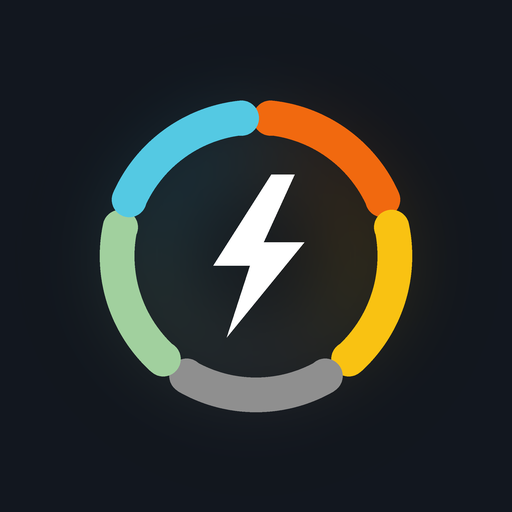

  

<h1 align="center">Tarifni semafor</h1>

  Časovni bloki omrežnine v Sloveniji na en pogled, ob njih pa tvoja lastna poraba.

---

**Tarifni semafor** je Android aplikacija za novo metodologijo obračuna omrežnine v Sloveniji. Pokaže, kateri časovni blok velja zdaj, kdaj se zamenja in kdaj je naslednji najugodnejši blok, da lahko večje porabnike vklopiš ob pravem času. Z neobvezno povezavo Moj Elektro vidiš tudi svojo 15-minutno moč ob časovnih blokih in dogovorjeni moči.

## Testna verzija

Aplikacija je v zaprtem testiranju na Google Play: https://play.google.com/apps/testing/si.semafor.app

Pred prenosom se pridruži skupini testerjev: https://groups.google.com/g/bsky_testira

Vabljen k testiranju.

## Funkcionalnosti

- **Trenutni časovni blok** z odštevanjem do naslednje menjave, ceno omrežnine za energijo in naslednjim najugodnejšim blokom v 24 urah.
- **Priporočila uro.si** za trenutni in naslednji blok (ogrevanje in hlajenje, gospodinjske naprave, polnjenje vozila).
- **Semafor porabe** (neobvezno, povezava Moj Elektro): interaktivni graf 15-minutne moči ob uradnih časovnih blokih, dnevne konice s pragoma 90 % in 100 % dogovorjene moči, poraba po blokih za 7 ali 30 dni, prejeta in oddana energija ter podrobnosti registrov.
- **Obvestila** ob menjavi bloka (vsi bloki ali samo prehod v blok 1 ali 2) in ikona trenutnega bloka v vrstici stanja.
- **Pripomočka za začetni zaslon** (majhen in širok) s trenutnim, naslednjim in najugodnejšim blokom.
- **Cenik omrežnine** SODO za uporabniško skupino 0 in **kalkulator** okvirnega mesečnega stroška omrežnine ter povezava na primerjalnik ponudb Agencije za energijo.
- **Nasveti** za prilagajanje porabe in **novice** Agencije za energijo.
- **Svetla, temna ali sistemska tema** ter **slovenščina in angleščina** (izbira v Nastavitvah).
- Barve časovnih blokov so iz uradnih tabel uro.si in so v obeh temah enake; ob novem letu aplikacija uporabi tabelo tega leta.

## Zasebnost

- Brez registracije, računa, oglasov, piškotkov in analitike.
- Aplikacija ne zbira osebnih podatkov. Časovne bloke, cenik in novice prenaša z uradnih javnih virov.
- Neobvezna povezava Moj Elektro: žeton API (samo branje), EIMM in meritve ostanejo samo v telefonu, šifrirani s ključem v Android Keystore (AES-256-GCM), in niso del varnostnih kopij. Aplikacija jih pošilja samo uradnemu strežniku `api.informatika.si`, nikoli razvijalcu ali tretjim. Prekinitev povezave izbriše žeton, EIMM in vse shranjene meritve.
- Podatki Moj Elektro niso v realnem času: objavljeni so z zamikom, običajno približno en dan.

## Tehnologija

| Komponenta | Tehnologija |
| :--- | :--- |
| Jezik | Kotlin |
| Uporabniški vmesnik | Jetpack Compose (Material 3), pripomočki z RemoteViews |
| Arhitektura | ViewModel, StateFlow, korutine, WorkManager |
| Omrežje | HttpURLConnection, org.json, XmlPullParser (brez dodatnih knjižnic) |
| Hramba | Zasebni prostor aplikacije; podatki Moj Elektro šifrirani (Android Keystore) |
| Jezika | Slovenščina (privzeto) in angleščina |
| Minimalni Android | 8.0 (API 26) |
| Uradni viri podatkov | Agencija za energijo ([uro.si](https://www.uro.si)), SODO, Moj Elektro |

### Neobvezna povezava Moj Elektro (paket `si.semafor.app.mojelektro`)

| Del | Datoteka |
| :--- | :--- |
| HTTP odjemalec (glava `X-API-TOKEN`, brez preusmeritev) | `MojElektroClient.kt` |
| Razčlenjevanje JSON po uradni specifikaciji OpenAPI | `MojElektroParser.kt` |
| Šifriranje (Keystore) in shramba povezave | `MojElektroCrypto.kt`, `MojElektroCredentialStore.kt` |
| Repozitorij in preverjanje povezave | `MojElektroRepository.kt` |
| Šifriran predpomnilnik meritev, urnik blokov z uro.si | `UsageCache.kt`, `BlockSchedules.kt` |
| Analiza (čisti Kotlin, enotni testi) | `UsageAnalysis.kt`, `UsageInsights.kt` |
| Stanje zaslonov | `MojElektroViewModel.kt`, `UsageViewModel.kt`, `UsageRepository.kt` |
| Grafi (Compose Canvas, brez knjižnice) | `ui/compose/charts/` |

Kode registrov (A+, A-, A+_T0, A-_T0) se preberejo iz uradnega kataloga `GET /reading-type`. Časovni blok vsake ure preteklih dni se pridobi z uradnega API-ja uro.si; pravila blokov niso zapisana v aplikaciji. Ali časovna oznaka 15-minutne meritve pomeni začetek ali konec intervala, aplikacija ugotovi iz podatkov (primerjava z dnevnim stanjem števca).

## Opombe izdaje

Podrobne opombe vsake izdaje so v mapi `store_assets/` (`release_notes_<verzija>.md`).

### 2.2.3 (versionCode 19)

Spremembe od verzije 2.2.2 (versionCode 18):

- Ves uporabniški vmesnik je prenesen na Jetpack Compose (Domov, Novice, Cenik, meni, okna); stara View koda je odstranjena.
- Nov zavihek Semafor porabe (neobvezna povezava Moj Elektro): interaktivni graf moči po četrturah ob uradnih časovnih blokih uro.si, dnevne konice s pragoma 90 % in 100 %, poraba po blokih (7/30 dni), prejeta in oddana energija, moč po blokih in registri.
- Barve časovnih blokov po uradnih tabelah uro.si (2026, 2027), enake v svetli in temni temi; ob novem letu se uporabi tabela tega leta.
- Svetla, temna ali sistemska tema; izbira jezika slovenščina / English (privzeto slovenščina).
- Spodnja vrstica Domov / Semafor porabe / Nastavitve, usklajena s podrsanjem; meni ostane za orodja.
- Prenovljene Nastavitve: videz in jezik, povezava Moj Elektro z enim dotikom za izbris, obvestila, nasveti in orodja, zasebnost, pravno.
- Okno o zasebnosti ob prvem zagonu: brez računa, oglasov in piškotkov; izbira o analitiki je privzeto izklopljena (analitika ni vgrajena).
- Nov logotip (obroč petih časovnih blokov s strelo), ki v aplikaciji sledi trenutnemu bloku; nova ikona aplikacije.
- O aplikaciji: »Aplikacijo razvila: primus in Claude«.
- Okostja z lesketanjem med nalaganjem, rahla vibracija ob menjavi zavihka in ob drsenju po grafu.
- Podpora uradni specifikaciji API Moj Elektro (opisi statusov meritev), šifriranje Keystore varno tudi ob sočasnem prvem zapisu, hitrejša analiza 15-minutnih meritev.

## Pravno obvestilo

**Tarifni semafor je neodvisen in neuraden projekt.** Aplikacija ne predstavlja nobenega državnega organa ali operaterja in ni uradni izdelek Agencije za energijo, družbe SODO d.o.o. ali portala Moj Elektro. Podatki so informativni; pravno zavezujoče podatke objavljajo izključno uradni viri.

Aplikacijo razvila: primus in Claude.
